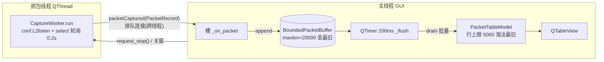
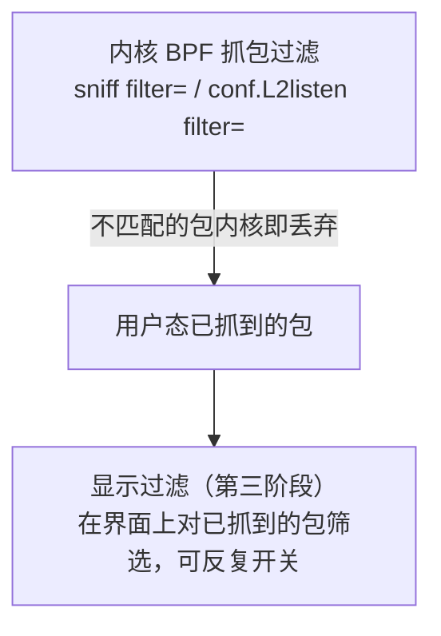

# 线程通信与抓包刷新（示意图）

> 注意：本文件为**设计示意图**，非运行截图。可编辑源即下方 Mermaid 文本。

## 线程与信号模型

## 关键点

- 子线程只发信号，**不触碰任何 Widget**。
- 包→记录的解析在子线程完成，主线程只收轻量 `PacketRecord`。
- 两级有界：缓冲层（丢最旧）+ 表格行上限（淘汰最旧），高流量下内存不无限涨。
- GUI 不逐包刷新：QTimer 每 200ms 批量 drain 一次。
- 停止：`request_stop()` 置位 Event，select 轮询最多 0.2s 内退出循环，finally 关 socket。

## 两种过滤的层级区别（示意）

